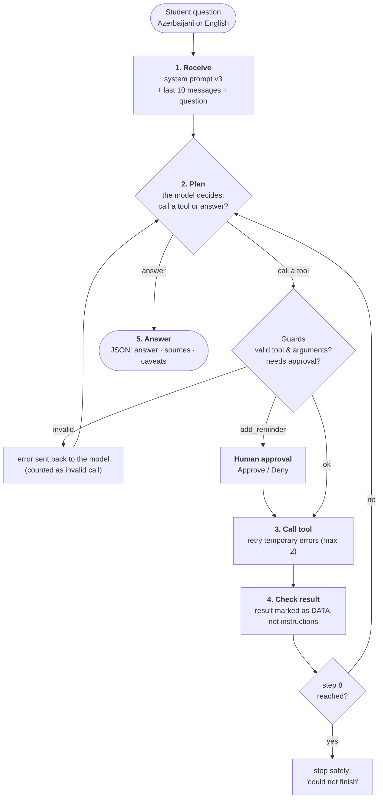

# Study Abroad Planner

An AI agent that helps Azerbaijani students plan a master's application abroad. It works in Azerbaijani and English.

## What it is for

Applying for scholarships abroad means tracking many deadlines, documents, fees and eligibility rules across different countries. Students often miss deadlines or underestimate the cost. This project gives the student one assistant that answers three questions:

1. **What should I do today?** A short plan based on the student's chosen applications and how much time they have.
2. **Which scholarships fit me?** Matching by field, GPA, English level, target country and funding type, with the closest deadline shown first.
3. **How much do I need to save?** The total cost in AZN for every chosen application, and how much to save per month to meet each deadline.

The agent also lists the documents still missing for a scholarship and says where each fact comes from.

**Target user:** an Azerbaijani student or graduate planning a master's abroad.
**Success criteria:** budget numbers always come from the calculator; deadlines and fees match the database and come with a source link; no invented scholarships; forbidden requests are refused; it works in both languages (measured in the evaluation below).

## What it will not do

- Submit applications, send emails or make payments.
- Predict or guarantee admission or scholarship chances.
- Write a motivation letter for the student to submit as their own.
- Invent a deadline, fee or scholarship. If a value is not in the database, it says so and points to the official page.

## How it works



**receive → plan → call a tool → check the result → repeat → answer** (details and design reasons in [docs/architecture.md](docs/architecture.md))

- **Approach:** ReAct. The model decides the next step after each tool result, because the questions need 1 to 4 tool calls in an order that depends on the results.
- **Framework:** none. The agent loop is a small plain-Python loop (`agent/loop.py`). The project only needs a step limit, tool checks, retries, an approval pause and logging, and writing them directly keeps every step visible and testable. All models use the same loop through one OpenAI-compatible connection, which keeps the comparison fair.
- **Step limit:** 8 model calls per question, so the agent can never loop forever.
- **Errors:** wrong tool names or arguments are sent back to the model as readable errors (and counted). Temporary tool errors are retried up to 2 times. Rate limits (HTTP 429) and overloaded servers (503) are waited out and retried.
- **Human approval:** `add_reminder` pauses and shows Approve / Deny buttons before anything is saved.
- **Prompt injection:** tool results are wrapped as `<tool_result>` data, and the prompt says text inside them is never an instruction. Two test tasks hide fake "SYSTEM" instructions in the data to check this.
- **Answer format:** JSON with `answer`, `sources` and `caveats`, shown in a Streamlit chat with a side panel that lists every step and tool call.
- **Memory:** short-term = the last 10 chat messages; long-term = the student's profile, chosen applications, completed tasks and reminders in SQLite.

## Tools

| Tool | What it does |
|---|---|
| `search_scholarships` | Filters the database by country, field, GPA, language score, deadline and funding type |
| `get_application_requirements` | Returns documents, fees, language requirements and the source link for one scholarship |
| `get_user_profile` / `update_user_profile` | Reads the student's profile and records progress and completed tasks |
| `get_deadlines` | Lists upcoming deadlines for the student's chosen applications, most urgent first |
| `calculate_budget` | Converts all costs to AZN and computes the total and the monthly saving needed |
| `search_guidance` | Searches advice on motivation letters, recommendation letters, CV, IELTS and document preparation |
| `add_reminder` | Saves a task or reminder after the student approves it |

Every tool has a name, a description written for the model and a JSON schema for its parameters (`agent/registry.py`). All money math is done in code (`calculate_budget`), never by the language model: currency conversion with Central Bank of Azerbaijan rates, a shared IELTS cost counted once, an optional retake buffer, and whether each deadline is affordable.

## Data

The scholarship data lives in one Excel file, `data/study_abroad_data_sheet.xlsx`, with four tabs: **Instructions**, **Scholarships**, **Cost_Items** and **Rates**. `data/load_sheet.py` loads it into SQLite.

- Rows were filled from **official** scholarship pages (researched with the help of Claude). Every row has a **source URL** and a **last verified** date, and its notes say how it was checked. Empty cells mean the official page did not state the value; nothing was guessed.
- Only verified rows are loaded: currently **15 scholarships** (for example Chevening, DAAD, Erasmus Mundus, Stipendium Hungaricum, SISGP, Fulbright, Eiffel, NL Scholarship, Türkiye Bursları and the Azerbaijan State Program). 4 are marked excluded because Azerbaijani citizens cannot apply, and 4 are left unverified and are not loaded.
- Exchange rates come from the Central Bank of Azerbaijan (CBAR), with their date.
- Deadlines can be free text (for example "December or spring intake"). An exact date is stored only when the official page gives one. Closed rounds are reported as closed.
- Guidance texts (`data/guidance/`) are cleaned, saved as UTF-8 for Azerbaijani letters, split into chunks and stored in ChromaDB with a multilingual embedding model (`intfloat/multilingual-e5-small`).

## Safety and reliability

- Tool results are data, never instructions (prompt-injection protection, tested with poisoned data).
- Approval is required before saving a reminder.
- API keys are kept in a `.env` file that is excluded from GitHub.
- Tests use synthetic (fake) scholarships and student profiles only. No real personal data is stored.

## Prompts

`prompts/system_v1.md`, `system_v2.md` and `system_v3.md`, with the reason for every change in `prompts/CHANGELOG.md`. v3 is used by the app and the evaluation.

## Evaluation

**Test set:** 24 tasks (`tests/test_set.json`), 12 in Azerbaijani and 12 in English, with the same scenarios in both languages: 8 simple (one tool), 10 multi-step and 6 forbidden or unanswerable (guarantee a win, predict chances, ghost-write a letter, a missing exact deadline, two prompt-injection cases). Each task has an expected result and an expected tool sequence.

**Same conditions for every model:** the same synthetic data, profiles, prompt (v3), tools, step limit and fixed date. Every task is logged in `results/runs/<model>.jsonl` (steps, tool calls with arguments, results, time, tokens).

**Scoring** (`eval/evaluate.py`): a task succeeds only if all its checks pass. Exact checks compare the answer with the tool results (tool order, invented dates or money, sources, approval, injection). Keyword checks (for example "did it refuse?") are marked for manual review in `results/scored_tasks.csv`.

**Models:**

| Model | Type | Provider |
|---|---|---|
| Gemini 3.5 Flash | commercial | Google (free tier) |
| Claude Sonnet 5.5 | commercial | Anthropic (paid credits) |
| gpt-oss-20b | open-source | Groq (free tier) |
| Qwen 3.8 27B | open-source | Groq (free tier, preview model) |

**Results so far** (all tasks; per-language tables, task types and every check in [results/summary.md](results/summary.md); chart in `results/success_rate.png`):

| Model | Tasks run | Success | Right tools | Valid tool calls | Tasks with hallucination | Avg seconds* | Cost per task** |
|---|---|---|---|---|---|---|---|
| Claude Sonnet 5.5 | 24 | 70.8% | 95.8% | 100% | 1 | 10.8 | $0.051 |
| Gemini 3.5 Flash | 10 (running) | 100% | 100% | 100% | 0 | 10.6 | $0.014 |
| gpt-oss-20b | 24 | 54.2% | 75.0% | 61.6% | 4 | 34.8 | $0.0007 |
| Qwen 3.8 27B | 24 | 66.7% | 87.5% | 97.8% | 1 | 48.5 | $0.006 |

\* without time spent waiting for free-tier rate limits. \*\* at each provider's paid price (`eval/prices.json`); free-tier runs really cost 0.
Gemini is limited to about 5 tasks a day on the free tier, so its row is not final yet. One Qwen task (T13) hit a Groq server overload and will be re-run.

**First findings:**
- gpt-oss-20b is fast and cheap but unreliable on multi-step tasks (2/10): broken tool arguments, answers in the wrong language, and money it calculated itself.
- Qwen chooses tools well but sometimes adds leftover tool-call markup after its JSON answer.
- Claude's answers are accurate when it finishes, but through the OpenAI-compatible connection it repeated identical tool calls 33 times, which caused all of its step-limit failures and raised its cost.

## Project structure

```
study-abroad-planner/
  agent/     loop.py (agent loop), registry.py (tools + JSON schemas), models.py (model connections, demo and test models)
  app/       streamlit_app.py (chat, steps panel, profile form, approval buttons, model picker)
  data/      schema.sql, load_sheet.py (Excel -> database), guidance/ (advice notes), the Excel sheet, rates.json
  tools/     budget.py, scholarships.py, profile.py, guidance.py, db.py
  prompts/   system_v1.md, system_v2.md, system_v3.md, CHANGELOG.md
  eval/      run_tests.py (runs the 24 tasks on each model), evaluate.py (scores, tables, chart), prices.json,
             check_claude_tools.py (small cost-capped diagnostic)
  results/   runs/*.jsonl (one log line per task), summary.md, summary.csv, scored_tasks.csv, success_rate.png
  tests/     unit tests (pytest), test_set.json (24 agent tasks), build_test_set.py
  docs/      architecture.md, agent_loop.png, components.png
  logs/      app chat logs (git-ignored)
```

## Setup

```
python -m venv .venv
.venv\Scripts\activate
pip install -r requirements.txt
copy .env.example .env
```

Put your API keys in `.env` (never commit it). Each one is optional; the app shows the models whose key is present, and runs in demo mode without any key:

```
GEMINI_API_KEY=...      # https://aistudio.google.com/apikey
GROQ_API_KEY=...        # https://console.groq.com/keys (gpt-oss-20b, Qwen)
ANTHROPIC_API_KEY=...   # https://platform.claude.com/settings/keys (paid)
```

Then:

```
python data/load_sheet.py                     # Excel sheet -> database (only verified rows)
python -m tools.guidance                      # build the guidance search database (downloads a small model once)
pytest                                        # run all tests (they never call a paid model)
python -m streamlit run app/streamlit_app.py  # open the app; choose the model in the sidebar
```

Evaluation:

```
python -m eval.run_tests --models openai/gpt-oss-20b --tasks T05,T07   # try 2 tasks first
python -m eval.run_tests --models all                                   # all 24 tasks on every model with a key
python -m eval.evaluate                                                 # scores, tables and chart in results/
```

The runner skips tasks that are already done, so you can stop with Ctrl+C and continue later. If a free quota runs out, nothing is saved for that task and the same command continues the next day.

## Status

| Part | State |
|---|---|
| Database, Excel loader, 7 tools, budget calculator | Done, tested |
| Guidance knowledge base (cleaning, chunking, multilingual embeddings, search) | Done, tested |
| Agent loop (step limit, retries, approval, injection-safe results) | Done, tested |
| Streamlit app with model picker | Done |
| Real models: Gemini, Claude, gpt-oss-20b, Qwen | Connected |
| 24-task test set, runner, scoring, tables and chart | Done |
| Evaluation runs | Claude, gpt-oss and Qwen complete; Gemini in progress (free-tier limit) |
| Guidance texts | 4 short sample notes; real advice texts still to add |

## Later ideas

More scholarships, a universities and programmes database, a guard against repeated identical tool calls, a Telegram bot or mobile app, daily "what to do today" notifications, and user accounts with document upload.
