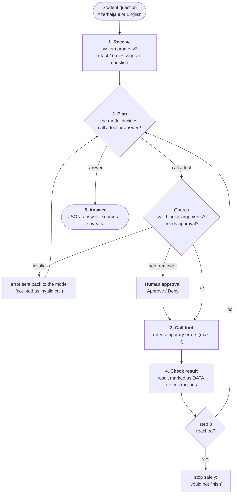
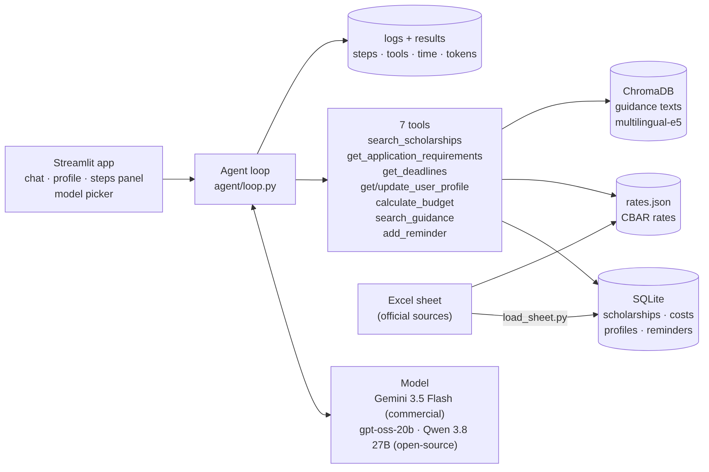

# Architecture

## 1. The agent loop (lifecycle)

1. **Receive**: the system prompt (prompts/system_v3.md), the last 10 chat messages (short-term memory) and the new question.
2. **Plan**: the model decides whether to call a tool or to answer.
3. **Call tool**: the tool name and arguments are checked first. Wrong ones are sent back to the model as an error and counted as invalid calls. `add_reminder` pauses for the student's Approve / Deny. Temporary tool errors are retried up to 2 times.
4. **Check result**: the tool result goes back to the model inside `<tool_result>` tags, marked as data and not instructions (protection against prompt injection). Then the model plans again.
5. **Answer**: a JSON object with `answer`, `sources` and `caveats`. The loop stops after 8 steps at most, so it can never run forever.

## 2. Components

- **Long-term memory**: the student's profile, chosen applications, completed tasks and reminders live in SQLite.
- **Knowledge base**: guidance texts are cleaned (UTF-8 for Azerbaijani letters), split into chunks, embedded with a multilingual model and stored in ChromaDB.
- **Money**: all calculations are done in code (`calculate_budget`) with Central Bank of Azerbaijan rates, never by the model.

## 3. Why this design

**Approach: ReAct (reason, act, observe, repeat).** The questions need 1 to 4 tool calls in an order that depends on the results. For example, "which scholarships fit me and how much do I need?" needs a search first, then the budget for what was found. A ReAct loop lets the model choose the next step after each result. A fixed plan (plan-and-execute) cannot react to an empty search, and a multi-agent setup would add complexity without better answers for a task this size.

**Framework: a small loop in plain Python (about 200 lines), no agent framework.** The project needs only a few features: a step limit, tool validation, retries, an approval pause and step logging. Writing them directly keeps every step visible and easy to test (96 automatic tests) and easy to explain. It also lets all three models use exactly the same loop through one OpenAI-compatible connection (Gemini and Groq), which keeps the model comparison fair. A framework such as LangGraph would add a large dependency for features this project does not need. The trade-off: no built-in graph visualisation, persistence or parallel tool calls, which this project does not need.
